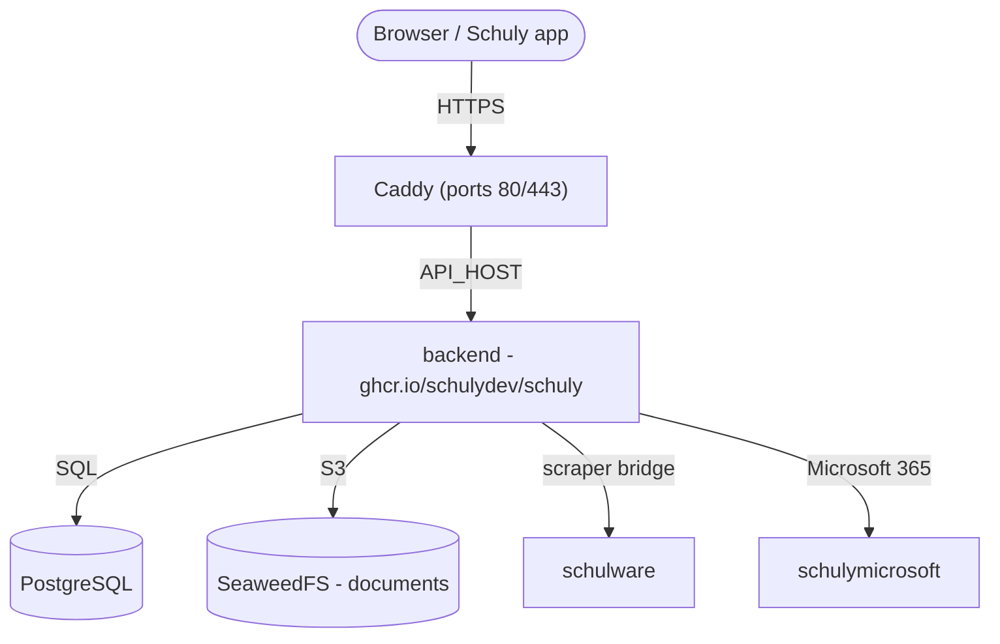

# Self-hosting

A from-zero walkthrough to stand up the Schuly backend **and the services it needs**
on your own server, using the published GHCR images and the ready-made stack under
[`deploy/`](https://github.com/schulydev/SchulyServer/tree/main/deploy). Everything
runs behind [Caddy](https://caddyserver.com/) with automatic HTTPS.

For local development instead, see [Development](development.md). For image/release
details and the full settings list, see [Production](production.md) and
[Configuration](configuration.md).

## What you'll run



| Service | Image | Exposed |
|---|---|---|
| `caddy` | `caddy:2` | **80 / 443** - the only public ports |
| `backend` | `ghcr.io/schulydev/schuly` | via Caddy → `https://${API_HOST}` |
| `postgres` | `postgres:18.1` | internal (database `schuly`) |
| `seaweedfs` | `chrislusf/seaweedfs` | internal - S3 document storage |
| `schulware` | `ghcr.io/pianonic/schulwareapi` | internal - Schulnetz bridge for the Schulware plugin |
| `schulymicrosoft` | `ghcr.io/schulydev/schulymicrosoft` | internal - Microsoft 365 access for the Microsoft plugin. Stores nothing. |

Sign-in is built into the backend: it issues and validates its own tokens and keeps
the accounts in the `schuly` database. There is no separate identity provider. The
backend applies its EF Core migrations automatically on startup, and downloads the plugins declared in
`config/plugins.yml` from the registry (no plugin DLLs are baked into the image).

## Prerequisites

- A Linux server with **Docker** and the **Compose plugin** (`docker compose`).
- Ports **80** and **443** open to the internet.
- A DNS record pointing at the server for the API (e.g. `api.schuly.example`). Caddy
  needs it resolvable before first start so Let's Encrypt can issue a certificate.
- An SMTP server for verification and password-reset mails.

## 1. Get the deploy files

Clone the repo (or copy just its `deploy/` folder) onto the server and enter it:

```sh
git clone https://github.com/schulydev/SchulyServer.git
cd SchulyServer/deploy
```

Everything below runs from `deploy/`, which looks like this before you've touched
anything:

```
deploy/
├── .env.example
├── Caddyfile
├── compose.staging.yml
├── config/
│   ├── backend.env
│   ├── plugins.yml
│   ├── plugins-config/
│   │   ├── Schuly.Plugin.Microsoft.yml
│   │   └── Schuly.Plugin.Schulware.yml
│   └── seaweedfs/
│       └── s3-config.json
└── README.md
```

By the end of this guide you'll also have `.env` (step 3, from `.env.example`) and a
`data/` folder (created automatically on first `up`, step 5) holding everything the
stack persists:

```
deploy/
├── .env                  # ← you create this
├── ...                   #   (unchanged files omitted)
└── data/                 # ← created on first `docker compose up`
    ├── postgres/
    ├── seaweedfs/
    ├── plugins/           # downloaded plugin DLLs
    ├── caddy/              # TLS certificates/state
    └── caddy-config/
```

## 2. Point DNS at the server

Create A/AAAA records for your hostname and wait for them to resolve to the server's
public IP. Until they do, certificate issuance will fail.

## 3. Configure secrets

Copy the template and fill it in:

```sh
cp .env.example .env
```

| Variable | What to set |
|---|---|
| `API_HOST` | Public hostname for the API, e.g. `api.schuly.example`. |
| `SCHULY_VERSION` | Backend image tag. `latest` follows every release; pin a version like `1.3.3` to decide yourself when to move. |
| `POSTGRES_USER` | Database user. |
| `POSTGRES_PASSWORD` | A strong database password. |
| `LOCAL_LOGIN_SIGNING_KEY` | Key that signs access tokens (required). Base64 of 32 bytes - generate with `openssl rand -base64 32`. A new key signs everybody out. |
| `TWO_FACTOR_ENCRYPTION_KEY` | Key that encrypts two-factor secrets (required). Base64 of 32 bytes - generate with `openssl rand -base64 32`. A new key breaks two-factor for every account. |
| `S3_ACCESS_KEY` | SeaweedFS S3 access key. |
| `S3_SECRET_KEY` | SeaweedFS S3 secret key. |
| `AVATAR_SIGNING_KEY` | HMAC key for signing avatar URLs (required). Generate with `openssl rand -hex 32`. |
| `DOCUMENTS_ENCRYPTION_KEY` | Master key for encrypting student documents at rest (required). Base64 of 32 bytes - generate with `openssl rand -base64 32`. Losing it makes stored documents unreadable. |
| `VAULT_MASTER_KEY` | Master key for the plugin vault, which holds the school and Microsoft sign-ins plugins sync with (required - the backend refuses to start without it). Base64 of 32 bytes - generate with `openssl rand -base64 32`. A new key makes every stored sign-in unreadable, so everyone has to reconnect their school. |
| `SMTP_HOST`, `SMTP_PORT`, `SMTP_FROM`, `SMTP_USER`, `SMTP_PASSWORD` | Mail server for email verification and password reset. |
| `FIREBASE_SERVICE_ACCOUNT_JSON` | Optional. Base64 of a Firebase service-account JSON, for push notifications - generate with `base64 -w0 service-account.json`. Leave unset to run without push. |

> The S3 credentials **must match** `config/seaweedfs/s3-config.json` - update both
> the `.env` and that file to the same values, or document storage won't authenticate.

### Account deletion

`DELETE /api/auth/me` erases everything the backend stores about the caller: their school
users and all grades, absences, agenda entries, semester reports and documents (including
the objects in S3), then the account row itself. The sign-in account (credentials,
tokens, two-factor) is deleted in the same step.

### Retention

The backend runs a retention sweep once a day, starting five minutes after startup. It
drops cached school data for school users whose `LeaveDate` is further back than
`Retention__MonthsAfterLeave` (6 months), and deletes accounts that have not made an
authenticated request for `Retention__MonthsInactive` (12 months). Both thresholds, and
the `Retention__Enabled` switch, live in
[`config/backend.env`](https://github.com/schulydev/SchulyServer/blob/main/deploy/config/backend.env).

The sweep deletes only Schuly data, not sign-in accounts, so someone whose cached data
expired can sign in again and resync.

### Where the rest of the settings live

`.env` holds what changes per deployment. The backend's own settings sit next to the
other config files, and read `${...}` values straight out of `.env`:

| File | Holds |
|---|---|
| [`config/backend.env`](https://github.com/schulydev/SchulyServer/blob/main/deploy/config/backend.env) | Backend settings - database connection, sign-in, SMTP, S3, plugin paths. |

You normally don't touch it; it exists so `compose.staging.yml` stays readable as a
picture of the stack rather than a wall of environment variables.

## 4. (Optional) Review the plugins

`config/plugins.yml` lists the plugins the backend loads on startup (the Schulware,
OdaOrg and Microsoft plugins by default), and `config/plugins-config/` holds each plugin's
configuration. The Microsoft plugin talks to the `schulymicrosoft` service through
`MicrosoftApi.BaseUrl` in `Schuly.Plugin.Microsoft.yml`; it refuses to start without
that setting. To run without Microsoft 365, drop the plugin from `plugins.yml` and the
`schulymicrosoft` service from the compose file.
The absence reasons offered per school are configured under `AbsenceReasons` in `Schuly.Plugin.Schulware.yml`, keyed by the host of the school's Schulnetz URL.
Each plugin also **provides its own school-system catalog entry** - the system the
app shows in its picker (Schulware contributes `schulnetz`, OdaOrg `odaorg`) - so
installing a plugin adds its system automatically, with no catalog config. The
defaults work out of the box; adjust only if you need to.

## 5. Start the stack

```sh
docker compose -f compose.staging.yml up -d
docker compose -f compose.staging.yml logs -f backend
```

On first start: Postgres creates the `schuly` database, the backend applies its
migrations and seeds the school-systems catalog from the loaded plugins, and Caddy
obtains a TLS certificate for the hostname.

## 6. Verify end-to-end

- `https://${API_HOST}/api/app/school-systems` → the anonymous catalog endpoint,
  proving the API is up (`/api/app` is the only unauthenticated route).
- `https://${API_HOST}/api/app` → the app config (also anonymous); its `version` field
  reports the running backend version - handy for confirming a deploy or upgrade.
- Plugins are declared in `plugins.yml`; the backend log lists what was loaded.
- Point the Schuly app at `https://${API_HOST}`. It signs in against the backend's
  `/auth` endpoints.

## 7. Create your first login

Open the web app at `https://${API_HOST}` and register, or call
`POST https://${API_HOST}/auth/register` directly. Confirm the address through the
link in the verification mail. Everyone registers the same way, from the web app or
the Schuly app. There is no admin role: every account is equal and only sees its own
data. Plugins are managed in `plugins.yml`.

## 8. Harden for production

- Rotate every secret in `.env` that still has its example value. Do it before the
  first users register: changing `LOCAL_LOGIN_SIGNING_KEY` or
  `TWO_FACTOR_ENCRYPTION_KEY` later signs everybody out or breaks two-factor.
- Keep the management/internal services unexposed - only Caddy should publish ports.

## Running without a public domain (LAN / local testing)

Everything above assumes a real domain with DNS you control, so Caddy can get you a
Let's Encrypt certificate. If you just want to run the stack on your own network -
testing against a phone over Wi-Fi, no domain, no TLS - a few things change.

The app (phone, browser, emulator) needs a stable address for the backend. Two ways
to get one without a real domain:

- **Your machine's LAN IP, used directly** - `API_HOST=192.168.1.42`, no hostname at
  all. Simplest, and reachable from a phone on the same Wi-Fi. Downside: breaks if
  the IP changes (new DHCP lease), and it's only reachable from that network.
- **A wildcard-DNS hostname pointed at your LAN IP**, e.g. `<ip>.nip.io` or
  `<ip>.sslip.io` - these publicly resolve straight back to the IP encoded in the
  name. Nicer than a raw IP, but **many consumer routers block it**: DNS-rebind
  protection (on by default on most FritzBox/AVM routers, among others) refuses to
  resolve a public hostname that points at a private address, so the name won't
  resolve for anyone on that network at all. If lookups mysteriously fail with no
  useful error, this is almost always why - fall back to the raw IP instead.

Without a hostname Caddy can't get a certificate, so it serves plain HTTP on a fixed
port instead.

### Worked example

Say your machine's LAN IP is `192.168.1.42`. Nothing about the `deploy/` folder
structure from step 1 changes - you're editing three of the existing files in place,
nothing more:

```
deploy/
├── .env                  ← create from .env.example; API_HOST = the LAN IP
├── Caddyfile              ← edit: plain HTTP, explicit port
├── compose.staging.yml    ← edit: caddy service ports
├── config/
│   ├── backend.env        ← edit: http mail links
│   ├── plugins.yml         (unchanged)
│   ├── plugins-config/
│   │   ├── Schuly.Plugin.Microsoft.yml   (unchanged)
│   │   └── Schuly.Plugin.Schulware.yml   (unchanged)
│   └── seaweedfs/
│       └── s3-config.json                (unchanged)
└── data/                  (created on first `up`, same as the domain case)
```

**`.env`** - same template as step 3, just point the hostname at the raw IP:

```sh
API_HOST=192.168.1.42
SCHULY_VERSION=latest
POSTGRES_USER=schuly
POSTGRES_PASSWORD=change-me-postgres
LOCAL_LOGIN_SIGNING_KEY=<openssl rand -base64 32>
TWO_FACTOR_ENCRYPTION_KEY=<openssl rand -base64 32>
S3_ACCESS_KEY=schuly-access
S3_SECRET_KEY=change-me-s3-secret
AVATAR_SIGNING_KEY=change-me-avatar-signing-key
DOCUMENTS_ENCRYPTION_KEY=change-me-documents-encryption-key
VAULT_MASTER_KEY=<openssl rand -base64 32>
```

Keep the `SMTP_*` values, or point them at an SMTP catcher on your network, so the
verification mails arrive somewhere.

**`Caddyfile`** - replace the whole file (the domain-based version obtains a TLS cert;
this one just proxies plain HTTP on a port):

```
http://{$API_HOST}:8080 {
	reverse_proxy backend:8080
}
```

**`compose.staging.yml`** - in the `caddy` service, swap the `ports:` list (drop
`443:443`, there's no certificate to serve):

```yaml
  caddy:
    image: caddy:2
    restart: unless-stopped
    ports:
      - "8080:8080"
    environment:
      API_HOST: ${API_HOST}
    volumes:
      - ./Caddyfile:/etc/caddy/Caddyfile:ro
      - ./data/caddy:/data
      - ./data/caddy-config:/config
    depends_on:
      - backend
```

**`config/backend.env`** - the mail links must point at the plain-HTTP address:

```
Email__Smtp__PasswordResetLinkTemplate=http://${API_HOST}:8080/reset-password?token={token}
Email__Smtp__EmailVerificationLinkTemplate=http://${API_HOST}:8080/verify-email?token={token}
```

Then start it exactly as in step 5:

```sh
docker compose -f compose.staging.yml up -d
docker compose -f compose.staging.yml logs -f backend
```

And verify with the same checks as step 6, just `http://` and a port instead of
`https://`:

```sh
curl http://192.168.1.42:8080/api/app/school-systems       # anonymous catalog
```

Everything else - DNS-independent steps like plugin loading and the first-login
walkthrough above - works exactly the same. One more thing worth knowing:
Windows Firewall may silently block a phone on the same Wi-Fi from reaching these
ports the first time - allow Docker Desktop on the **Private network** if prompted, or
add an inbound rule for the ports yourself.

## Operations

- **Persistence** - all state is **bind-mounted to host folders under `./data`** (no
  named volumes): `data/postgres`, `data/seaweedfs`, `data/plugins`, `data/caddy*`.
  This is the recommended setup - your data stays visible and easy to back up on the
  host. The folders are created on first `up`, and a one-shot `init-perms` service
  makes `data/plugins` writable by the backend's user automatically, so it just works
  on first run. To wipe, stop the stack and delete `./data`.
- **Upgrades** - set `SCHULY_VERSION` in `.env` to a fixed version rather than
  `latest`, so a deploy repeats exactly and you choose when to move. Change the
  version, then `up -d` to roll forward. Migrations run automatically on the new
  container; back up `data/postgres` before major jumps.
- **Moving off Keycloak** - older deployments ran a separate Keycloak container.
  Passwords can't be carried over from Keycloak, so existing users register again
  (or reset their password). Add the new sign-in settings to `.env` (step 3), drop the
  `AUTH_HOST`, `KEYCLOAK_VERSION` and `KC_*` variables, and take the new
  `compose.staging.yml`, `Caddyfile` and `config/` files from the repo.
- **Plugin changes** made through the API are persisted back to `config/plugins.yml`.

## Reference: the full `compose.staging.yml`

For convenience, the complete stack this guide runs (the same file lives in the
repo's `deploy/` folder). All state is bind-mounted under `./data` - no named
volumes - and a one-shot `init-perms` service makes the plugins folder writable by
the backend on first start, so a plain `docker compose up` just works.

```yaml
services:
  # One-shot: make the bind-mounted plugins folder writable by the backend's
  # non-root user (uid 1654) before it starts, so a plain `up` works on the very
  # first run with no manual chown. Runs once and exits.
  init-perms:
    image: busybox:1.37
    command: sh -c "mkdir -p /data/plugins && chown -R 1654:1654 /data/plugins"
    volumes:
      - ./data:/data
    restart: "no"

  postgres:
    image: postgres:18.1
    restart: unless-stopped
    environment:
      POSTGRES_USER: ${POSTGRES_USER}
      POSTGRES_PASSWORD: ${POSTGRES_PASSWORD}
      POSTGRES_DB: schuly
    volumes:
      # postgres:18 stores data in a versioned subdir, so the data mounts at
      # /var/lib/postgresql (not /var/lib/postgresql/data, which it now rejects).
      - ./data/postgres:/var/lib/postgresql
    healthcheck:
      # -h 127.0.0.1 forces a TCP check. While the entrypoint runs the init
      # scripts it serves on the Unix socket only, so a socket-based check would
      # report healthy mid-init and let dependents connect to a server that is
      # about to restart.
      test: ["CMD-SHELL", "pg_isready -U ${POSTGRES_USER} -d schuly -h 127.0.0.1"]
      interval: 10s
      timeout: 5s
      retries: 10

  seaweedfs:
    image: chrislusf/seaweedfs:latest
    restart: unless-stopped
    command: >
      server -dir=/data
      -s3 -s3.config=/etc/seaweedfs/s3-config.json -s3.port=8333
      -master.volumeSizeLimitMB=1024
    volumes:
      - ./data/seaweedfs:/data
      - ./config/seaweedfs/s3-config.json:/etc/seaweedfs/s3-config.json:ro

  schulware:
    image: ghcr.io/pianonic/schulwareapi:latest
    restart: unless-stopped
    init: true
    ipc: host
    environment:
      # Schulnetz client id + PWA host are baked into the SchulwareAPI image as
      # defaults, so no Schulnetz config is needed here.
      PYTHONUNBUFFERED: "1"

  schulymicrosoft:
    image: ghcr.io/schulydev/schulymicrosoft:latest
    restart: unless-stopped
    environment:
      PYTHONUNBUFFERED: "1"

  backend:
    image: ghcr.io/schulydev/schuly:${SCHULY_VERSION:-latest}
    restart: unless-stopped
    env_file: [./config/backend.env]
    volumes:
      - ./data/plugins:/app/plugins                        # downloaded plugin DLLs (host folder)
      - ./config/plugins.yml:/app/plugins.yml              # desired plugin set (writable: endpoints rewrite it)
      - ./config/plugins-config:/app/plugins-config:ro     # per-plugin config
    depends_on:
      postgres:
        condition: service_healthy
      init-perms:
        condition: service_completed_successfully

  caddy:
    image: caddy:2
    restart: unless-stopped
    ports:
      - "80:80"
      - "443:443"
    environment:
      API_HOST: ${API_HOST}
    volumes:
      - ./Caddyfile:/etc/caddy/Caddyfile:ro
      - ./data/caddy:/data
      - ./data/caddy-config:/config
    depends_on:
      - backend
```

